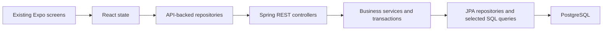

**Build a new Spring Boot/PostgreSQL backend and connect the existing Expo app directly to it.** Preserve the app's screens, navigation, scanner, cart, and business functionality. Replace its SQLite data access and remove synchronization.

Start in a new Git repository containing the copied Expo app under `app/` and this plan at `docs/online-first-rebuild-plan.md`. The current project is in `/home/syl/Projects/actual_projects/erp_mobile`; the planned new repository is `/home/syl/Projects/actual_projects/erp`. Create that repository when implementation is authorized. The first deliverable is a working online-first MVP on a development device, with PostgreSQL as the single source of truth.

This plan is self-contained. Build the backend from scratch directly in `backend/`. Use the copied Expo code to understand existing screens and business behavior, and verify that behavior against the rules below. No files, database migrations, API contracts, or Git history from the original backend are required.

When preparing the new repository, copy the app's source, assets, `package.json`, lockfile, Expo configuration, TypeScript configuration, and any other configuration its scripts use. Keep native source or configuration that contains intentional custom changes. Exclude the original `.git/`, `node_modules/`, `.expo/`, build outputs, credentials, and machine-specific environment files. Install dependencies from the copied lockfile. If the app was copied into the repository root, place it under `app/` before following the paths in this plan.

The copied app initially still contains SQLite and synchronization code. Its main integration points are `app/src/app/useAppState.ts` for application actions, `app/src/app/AppContent.tsx` for screen composition and worker startup, `app/src/db/` for local repositories, and `app/src/sync/` for synchronization. Existing screens and modals are under `app/src/components/`. Replace data access through these points while preserving the UI.

The target request flow is:



The app keeps form inputs, an unfinished cart, and fetched lists in memory. Shared data changes only through an explicit online request. A timeout can leave the result unknown even when the server committed the change. The app never falls back to a local business write or queues an operation for later transmission. It persists only small request-recovery markers so an uncertain submitted request can be looked up after a restart.

Accounts, authentication, device identity, object recognition, payment-provider integrations, cloud deployment, offline business storage, synchronization, WebSockets, and additional reporting are outside this MVP. Card and Pix selections continue to record the payment method only. Request-recovery markers are local bookkeeping, never authoritative business records or an offline-write mechanism.

Use a fresh PostgreSQL database and a new Docker Compose volume owned by the new repository. Configure its port so it can coexist with any database from the original project. Do not attach the original database volume. Historical-data import is outside this MVP. Copying app source does not copy a device's SQLite records, and this plan requires no reset of an existing database or device.

Use this small backend stack:

- Spring Boot with Spring MVC for HTTP endpoints.
- Bean Validation for request validation.
- Spring Data JPA with Hibernate as the main persistence approach.
- `JpaRepository` interfaces for ordinary entity creation, reads, and updates.
- PostgreSQL for persistent business data.
- Flyway for ordered database migrations.
- Maven Wrapper for repeatable build and test commands.

JPA defines how Java objects map to database rows. Hibernate implements JPA and generates most ordinary SQL. Spring Data JPA supplies repository implementations from interfaces such as `ProductRepository extends JpaRepository<Product, UUID>`. A repository interface is expected here; separate interfaces for services and controllers are unnecessary.

Organize Java code by feature, with controllers, concrete services, JPA entities, repository interfaces, and request/response DTOs. Controllers handle HTTP, services enforce business rules and own transactions, and repositories handle persistence. Keep this structure without adding a generic repository wrapper, a second domain model, or a mapping framework.

A DTO is the data shape accepted or returned by the API. Use explicit DTO classes or Java records and small manual mapping methods. Do not bind request bodies to entities or serialize entities from controllers. This keeps database relationships, internal fields, and lazy loading out of the API contract.

Use native SQL or `JdbcTemplate` where the benefit is concrete. Combined inventory history is a good example: a parameterized `UNION ALL` query can combine sale items and adjustments more clearly than loading both entity graphs and merging them. PostgreSQL-specific name comparison is another reasonable native query. Put such queries in the relevant feature repository or a small query class beside it. They do not require a new architectural layer. See Spring's [JPA query methods](https://docs.spring.io/spring-data/jpa/reference/jpa/query-methods.html) and [JdbcTemplate documentation](https://docs.spring.io/spring-framework/reference/data-access/jdbc/core.html).

When JPA and direct SQL participate in one business operation, use the same datasource and Spring-managed transaction. Hibernate keeps managed objects in a persistence context, an in-memory record of objects loaded during that transaction. Direct SQL does not automatically update those objects. Flush pending JPA changes before dependent SQL, and refresh or clear affected managed objects after direct SQL writes. Prefer one write approach per affected entity in a transaction when possible, and test any mixed path against PostgreSQL. See Spring's [JPA transaction integration](https://docs.spring.io/spring-framework/reference/data-access/orm/jpa.html).

As each feature is implemented, explain its entity mapping, repository methods, DTO mapping, and transaction in the implementation handoff. Use the code for that feature as the teaching example. Introduce locking and persistence-context behavior when inventory operations need them. Avoid advanced mappings or optimizations until a concrete query or correctness problem calls for them.

The intended final repository layout is:

```text
app/
  App.tsx
  src/
    api/client.ts
    api/requestRecovery.ts
    repositories/product.ts
    repositories/stock.ts
    repositories/sale.ts
    repositories/index.ts
    app/
    components/
    i18n/
    types.ts
    errors.ts
    formatters.ts
backend/
  pom.xml
  mvnw
  src/main/java/.../
    product/
    stock/
    sale/
    common/
  src/main/resources/
    application.yml
    db/migration/
  src/test/
docker-compose.yml
Makefile
.gitignore
.env.example
README.md
AGENTS.md
docs/
  online-first-rebuild-plan.md
  api-contract.md
```

Create root configuration and documentation in the new repository as the implementation progresses. The copied Expo app and this plan are the starting inputs. There is no old backend to replace, retire, or move between directories.

Implement the work in the following order. Each step has a concrete completion check.

1. **Define the new API and business rules.**

   Create `docs/api-contract.md` before implementation. Specify request/response DTOs, error codes, money units, idempotency rules, and recovery lookup behavior. Keep the existing app's business types where practical, with API repositories converting integer cents to the decimal values its components currently display. Entity property names and associations do not determine the JSON contract.

   Use these endpoints:

   | Method and route | Responsibility |
   | --- | --- |
   | `GET /healthz` | Report that the API process is running. |
   | `GET /api/v1/products` | Return active products. |
   | `GET /api/v1/products/by-barcode?barcode=...` | Find an active product by exact barcode. |
   | `POST /api/v1/products` | Create a product with initial stock. |
   | `PATCH /api/v1/products/{id}` | Update product metadata, excluding stock. |
   | `DELETE /api/v1/products/{id}` | Hide a product while preserving historical references. |
   | `POST /api/v1/products/{id}/stock` | Apply a signed stock adjustment. |
   | `GET /api/v1/stock/adjustments/by-request-id/{requestId}` | Retrieve a committed adjustment without applying it again. |
   | `GET /api/v1/stock/history?limit=50` | Return combined adjustment and sale history. |
   | `PATCH /api/v1/stock/adjustments/{id}` | Change only an adjustment reason. |
   | `GET /api/v1/sales` | Return sales with item snapshots. |
   | `POST /api/v1/sales/checkout` | Validate and record one complete sale. |
   | `GET /api/v1/sales/by-request-id/{requestId}` | Retrieve a committed checkout without submitting it again. |

   Return empty collections as arrays. Keep list ordering compatible with the current screens. Full lists are sufficient for the MVP; pagination and server search can wait until the dataset requires them.

   Use stable errors such as `product_missing`, `product_name_taken`, `barcode_taken`, `insufficient_stock`, and `cash_received_invalid`. Include structured shortage details. Distinguish validation errors, missing resources, business conflicts, and unexpected server failures through HTTP status codes.

   The two request-ID lookups return `200` with a response DTO containing the committed resource and its request ID. A lookup miss returns `404 request_not_found`. A miss means no committed result is visible at that moment; the original request may still be executing. It does not prove that the operation failed or was cancelled. Both lookups are read-only and never submit or resume an operation.

   Initial product stock is an opening balance and does not create an inventory-history row. This preserves the copied app's behavior. A product created with stock 10 and no later activity has stock 10 and an empty history. A later adjustment of +2 creates a +2 history entry and results in stock 12. Zero or negative opening stock follows the same rule. Do not synthesize an `initial-stock` adjustment or describe history as a complete ledger whose sum reconstructs current stock.

   Completion check: every current product, stock, scanner lookup, checkout, and history action has a defined request and response. The contract explicitly covers initial stock and restart recovery. No endpoint depends on push/pull synchronization.

2. **Create the Spring project and PostgreSQL schema.**

   Generate a fresh Spring project in `backend/` with a supported Spring Boot/JDK combination, the selected dependencies, and Maven Wrapper. Configure datasource settings through environment variables. Create the root `docker-compose.yml` for a persistent development PostgreSQL instance and use a separate database for integration tests. Record example configuration in `.env.example` and keep actual secrets out of Git.

   Add Spring Data JPA and let Spring Boot manage compatible Hibernate dependencies. Flyway SQL migrations are the source of truth for tables, columns, foreign keys, checks, and indexes. Set `spring.jpa.hibernate.ddl-auto=validate` so Hibernate checks its mappings at startup without creating or changing tables. Set `spring.sql.init.mode=never` and do not use a competing `schema.sql` initializer. Apply schema changes through a new Flyway migration and update the entity mapping in the same change. See Spring Boot's [database initialization documentation](https://docs.spring.io/spring-boot/how-to/data-initialization.html).

   Set `spring.jpa.open-in-view=false`. Load required data and build response DTOs inside service transactions instead of letting JSON serialization trigger extra database queries. Hibernate schema validation is not a replacement for testing PostgreSQL constraints and indexes.

   Create a fresh Flyway schema with these business tables:

   | Table | Required data and constraints |
   | --- | --- |
   | `products` | Server-generated UUID, name, optional barcode, category, nullable `cost_cents`, `selling_price_cents`, signed integer stock, timestamps, and nullable `deleted_at`. |
   | `sales` | Server-generated UUID, `total_cents`, canonical `payment_method`, nullable `cash_received_cents`, timestamp, unique nonnull checkout `request_id`, and original request fingerprint. |
   | `sale_items` | UUID, sale/product references, line order, product-name snapshot, quantity, unit-price snapshot, and independent `line_total_cents`. |
   | `stock_adjustments` | UUID, product reference, signed nonzero quantity, optional reason, timestamp, unique nonnull adjustment `request_id`, and original request fingerprint. |

   A request fingerprint is a hash of normalized submitted fields, used to distinguish a retry from reuse of the same ID with different input. Keep its normalization explicit and test it. Request IDs are unique within each operation type, so a lookup always includes the sale or adjustment route. Store these fields on the business rows; no general operation-processing table is needed.

   Create `Product`, `Sale`, `SaleItem`, and `StockAdjustment` entities with explicit column mappings. Let the server generate new UUIDs. Use integer types for cents and stock, nullable wrappers where needed, and UTC instants for timestamps. Map payment values explicitly to the required lowercase strings rather than enum ordinals. Keep associations simple and lazy where present. Avoid bidirectional collections or cascading deletes unless a demonstrated use requires them; saved sale history must survive product soft deletion.

   Use `JpaRepository` for ordinary persistence and simple derived queries for active-product filtering and request-ID lookups. Add `@Query` only where a derived method is unclear or insufficient. Services use public `@Transactional` methods for complete business operations; calling `save` several times does not by itself make a multi-repository operation atomic. Calls must pass through Spring's service proxy, rather than relying on a method calling its own annotated method. Use runtime business exceptions for rejected writes so Spring's default rollback behavior applies, and translate them at the HTTP boundary. See Spring Data JPA's [transaction guidance](https://docs.spring.io/spring-data/jpa/reference/jpa/transactions.html).

   Inventory uses one shared locking rule. A repository query with `@Lock(LockModeType.PESSIMISTIC_WRITE)` loads the product by ID inside the service transaction, including a soft-deleted row so deletion can be checked after duplicate-request lookup. This database row lock makes a competing writer wait until that transaction commits or rolls back. Acquire multiple product locks one by one in sorted UUID order, after combining repeated product IDs. Use this rule for adjustments, checkout, product metadata edits, and soft deletion. In particular, a stale entity saved by a metadata request must never overwrite a concurrent stock change. See Spring Data JPA's [locking documentation](https://docs.spring.io/spring-data/jpa/reference/jpa/locking.html).

   Use PostgreSQL's default `READ COMMITTED` isolation with this locking protocol. Load products through the locking query before making changes, rather than first loading stale product entities through an unlocked query. After taking the lock, validate the current row and change only the fields allowed for that operation. Hibernate's dirty checking detects changes to managed entities and writes them when the transaction flushes or commits. A flush sends SQL but does not commit the transaction. Do not merge a detached product assembled from a request DTO. Do not rely on Java `synchronized`, button disabling, or `@Transactional` alone to prevent lost stock updates. Use bounded lock/transaction waits and return a translated retryable error if the transaction cannot complete.

   Enforce uniqueness for nonempty barcodes with a partial unique index. Preserve the current ASCII case-insensitive product-name comparison explicitly. Keep names and barcodes reserved across soft-deleted rows for this MVP, matching the existing app.

   Store money in integer cents. Validate inputs and calculated results within JavaScript's safe integer range before returning them to the app. Add database constraints for nonnegative monetary values, positive sale quantities, allowed payment methods, and foreign keys.

   Keep any demo seed data separate from production schema requirements. Create no outbox, processed-sync table, change log, cursor, or conflict table.

   Completion check: Flyway creates the schema before JPA validates it, mappings pass validation, restarting preserves data, and tests use their own PostgreSQL database. A deliberately mismatched entity mapping fails validation instead of silently modifying the schema.

3. **Implement products and connect the existing catalog.**

   Implement product listing, barcode lookup, creation, metadata editing, and soft deletion. Trim input, normalize an empty barcode to null, require a name, allow optional nonnegative cost, and require a nonnegative selling price. Initial stock must be an integer and default to zero. Metadata edits must leave stock unchanged.

   Implement ordinary product persistence through `JpaRepository`. Load an existing product under the shared write lock before editing metadata or setting `deleted_at`. Set permitted fields explicitly on that managed entity. Product metadata uses the last accepted write for this MVP. No client version field or optimistic conflict workflow is added; the row lock protects stock while metadata requests serialize.

   Map create/update DTOs to the allowed changes and map entities to response DTOs in the service. Keep database uniqueness constraints authoritative under concurrent creates. Any duplicate-name precheck must use the same ASCII folding as the Flyway index; Spring Data's general `IgnoreCase` behavior must not silently change that rule. Map a constraint violation to a stable API error after the failed transaction rolls back.

   Add `app/src/api/client.ts` with `fetch`, a request timeout, error parsing, and support for empty `204` responses. Add the product repository with the existing asynchronous function names where practical. Map API responses into the current `Product` shape and calculate display profit from cost and selling price.

   Update `useAppState.ts`, product type imports, and `ProductFormModal.tsx`. Preserve the current form, category suggestions, search, and scanner. For registration, scanning fills the form locally. For selling, barcode lookup calls the API.

   Treat only a genuine lookup miss as "product not found." A network error must show a retryable lookup error. Add a single-scan guard so repeated camera callbacks cannot add the same scan twice.

   Completion check: a product created in the app appears in PostgreSQL, survives an app restart, can be found by barcode, and can be edited or hidden through the existing UI. Failed requests preserve the form.

4. **Implement stock adjustments and history.**

   In one service transaction, check for a completed request with the same ID, lock the product using the shared write-lock method, recheck the request ID after any lock wait, validate the product, calculate the safe resulting stock, change the managed product, and save the adjustment through its `JpaRepository`. Accept positive and negative nonzero integers. Reject missing or deleted products for new adjustments. If either write fails, roll back both. Implement the request-ID lookup with an adjustment response DTO at this step, together with the duplicate-request rules in step 5.

   Product creation saves its initial stock directly and creates no adjustment. Keep this distinct from the signed adjustments implemented here. Allow historical reason edits even after a product has been hidden.

   Build history by combining sale items and manual adjustments. Return `source: "sale" | "adjustment"`, signed quantities, product names, reasons, and timestamps. Sale history uses its saved product-name snapshots. Sale-derived rows remain read-only. A native `UNION ALL` query returning history DTOs or a small read projection is appropriate here; explain its benefit instead of forcing a JPA entity model for the combined history.

   A reason edit updates only `stock_adjustments.reason`. Use a focused repository method with `@Modifying` and a JPQL `@Query` that sets only that column, checking the affected-row count, inside a service transaction. JPQL queries refer to entity names and properties; native SQL refers to tables and columns. Preserve the adjustment quantity, product stock, original timestamp, request ID, and original request fingerprint. Keep `sale-shortage-replenishment` as an internal reason code and translate it only for display.

   Replace stock repository calls in the existing hook and modals. Add submission states, preserve entered values on failure, and refresh the relevant product and history lists after success.

   Completion check: concurrent signed adjustments do not lose updates, duplicates have one effect, creation adds no history row, and reason-only edits do not change stock. Editing an automatic reason without changing its value preserves its internal code.

5. **Implement transactional checkout and sales history.**

   Keep the cart in React state. Send product IDs, quantities, payment method, cash received in cents when applicable, explicit insufficient-stock override IDs, an expected total in cents, and a checkout request ID.

   In one public service transaction, check for an existing request result, merge repeated product quantities, acquire product write locks in sorted ID order, recheck the request ID after any lock wait, validate current stock and product state, calculate prices from the locked products, validate payment, insert the sale and item snapshots through JPA repositories, and decrement the managed product stocks. A failure must leave no partial sale, item, or stock change. Build the sale response DTO within the transaction; return HTTP success only after it commits. Keep network calls and user confirmation outside the transaction.

   Preserve the canonical payment values `cash`, `debit_card`, `credit_card`, and `pix`. Cash received must cover the authoritative total. Noncash sales store no cash amount. Derive change from received cash minus total. Keep `line_total_cents` even though this MVP computes it from quantity and unit price.

   If the current server total differs from the expected total, return a structured conflict before writing the sale. Update the cart and ask the user to review the new total before confirming again. Return the completed sale after success.

   Preserve the shortage dialog and its choices. "Sell anyway" sends the accumulated set of explicitly approved product IDs. "Add stock for this sale" first saves a stock adjustment and then retries checkout. That adjustment remains if checkout later fails or is cancelled, matching the current behavior.

   Prevent duplicate online mutations with unique request IDs on sales and stock adjustments. Check existing results before validating mutable catalog prices or stock, so an already committed retry does not become a new stock/price failure. A matching original fingerprint returns the committed resource; a different fingerprint returns `409 request_id_reused`. Save request identity and fingerprint in the same transaction as the business change.

   A preliminary lookup is not sufficient when duplicate requests arrive concurrently. Repeat it after product locks are acquired and before validating mutable stock, prices, or deletion state. A duplicate that waited for the original transaction must return its committed result even if stock is now exhausted or the product has since been hidden. Keep database unique constraints as the final guarantee for races, including the same ID with different product sets. If two requests both miss the lookup, only one can insert the business row. Let the losing transaction roll back completely, including any stock changes, then read the winning result in a fresh service transaction and compare the fingerprint. Catch that specific duplicate-request constraint failure outside the failed transaction boundary. Do not catch a constraint error inside an aborted transaction and continue writing. Other constraint failures remain ordinary errors. Test this with two concurrent requests, including different bodies using the same ID.

   The request-ID endpoints return the committed sale or adjustment, even after a server restart. Adjustment lookup returns the saved resource with any later permitted reason edit; its fingerprint still identifies the original request. Lookup does not promise that current product stock is unchanged since that request. Do not add an operation queue, worker, or generic receipt table.

   Add `app/src/api/requestRecovery.ts` and AsyncStorage for minimal recovery markers. Before sending a checkout or stock-adjustment POST, generate a request UUID and await persistence of `{ requestId, operationType, apiBaseUrl, submittedAt }`. If that persistence fails, do not send the mutation. Persist no request body, cart, product row, or offline operation payload. Preserve all unresolved markers rather than replacing one with the next request.

   On startup, read these markers and offer a translated "Check previous request" action. Query the corresponding request-ID endpoint on its recorded API backend. Do not silently query a different server if configuration changed. A `200` result confirms the saved operation; show it, refresh the affected lists, and clear that marker. A definitive business rejection after rollback also permits clearing it. A timeout, network error, malformed response, or uncertain server failure keeps it available.

   Treat `404 request_not_found` as unresolved because an earlier POST may still be running or may have rolled back. Offer another lookup and manual reconciliation with server history. Never automatically resubmit, infer cancellation, or start a replacement under a new ID for that unresolved action. If the original input is still in memory, an explicit retry can reuse the same ID and unchanged body. After a restart, no payload exists to resend. The user can dismiss a reminder after checking the server; dismissal does not cancel an outstanding request. This deliberately preserves uncertainty instead of promising an outcome the API cannot prove.

   After a definitive rejection and rollback, such as a stock shortage or changed total, an explicitly revised submission uses a new request ID. This differs from retrying an uncertain submission, which must keep its original ID and body.

   Implement sales reads with saved line snapshots so `SalesTab.tsx` and `SaleDetailsModal.tsx` retain their current presentation. Load required sales and items in a read-only service transaction and map them to DTOs there. Start with a sales query plus a query for their items, grouped by sale ID. This avoids one lazy item query per sale without introducing complex fetch mappings. Keep complete sales reads initially so daily counts and revenue calculations remain correct.

   Completion check: payment rules work, insufficient stock rolls back checkout, concurrent stock consumption is safe, overrides permit negative stock, and concurrent duplicate requests have one effect. Lost-response results can be retrieved by request ID after both app and server restart. Historical names/prices survive catalog edits.

6. **Finish online loading, refresh, and error behavior.**

   Separate initial loading, list refreshes, barcode lookup, and mutation states. Do not make a failed history request hide an otherwise usable product screen. Keep previously fetched data visible when a refresh fails, with an error and retry action.

   Disable repeated submissions in both button state and the action handler. Preserve cart and form inputs on failure. Lock the submitted checkout contents while the request is in flight. A failed refresh after a confirmed mutation must not be presented as a failed mutation.

   Include the recovery markers in startup handling without treating them as unsent work. The app should offer lookup, never automatic mutation replay. Clearly distinguish a confirmed failure from an uncertain outcome, and keep the marker until confirmation or explicit manual reconciliation.

   Refresh the affected lists after success, when returning to the foreground, and through an explicit refresh action. There is no periodic synchronization worker. Do not represent a successful past request as proof that the connection is currently available.

   Keep Brazilian Portuguese as the default and English as fallback. Put all loading labels, connection messages, server-error translations, and changed local/offline wording in `app/src/i18n/index.ts`. Keep locale-aware BRL and date formatting.

   Keep `EXPO_PUBLIC_API_URL` as the API address setting. Document emulator and physical-device connectivity. A physical phone needs a reachable server address or configured ADB port forwarding.

   Convert and test repositories in stages, but do not ship a partially converted application that reads API products and writes SQLite sales. Disable unmigrated write paths in transitional builds until the complete sales flow uses the API.

   Completion check: losing connectivity produces clear errors, preserves user input, and creates no local business records. Restoring connectivity allows an explicit retry without replaying queued work.

7. **Remove the copied app's offline architecture and finish repository setup.**

   Remove `app/src/sync/` and `app/src/db/sync/`. Remove all operation-enqueue calls, worker startup, leases, retry scheduling, cursor handling, tombstones, and conflict hooks.

   Move retained business types into `app/src/types.ts` and the replenishment reason constant into `app/src/constants.ts`. Move API-backed functions into `app/src/repositories/` and update imports. Remove sync-only product version fields from the client contract. Remove obsolete SQLite repositories, schemas, initialization, and the transaction helper after verifying that nothing uses them. Retain or relocate a small UUID helper for online request IDs; remove its local-record and outbox uses. Keep AsyncStorage limited to recovery markers.

   Update `AppContent.tsx` to stop starting synchronization. Update `AppHeader.tsx`, `StartupScreen.tsx`, product-save labels, and catalog descriptions for online operation. Keep navigation, screen layouts, safe areas, keyboard handling, and camera behavior.

   Remove `expo-sqlite`, `expo-background-task`, and `expo-task-manager` from the package manifest and lockfile. Remove SQLite/background plugins from `app/app.json`. Account for any registered legacy background task during upgrade. Keep VisionCamera and its native configuration.

   Create the root Makefile with `app-start`, `app-typecheck`, `backend-run`, `backend-test`, and `db-up` targets. Point app commands at `app/` and backend commands at the Maven Wrapper in `backend/`. Configure `backend-test` to run unit/HTTP tests and document a separate command for real PostgreSQL integration tests. Normal startup commands must not reset data or build the native Android app.

   Create README instructions for installing app dependencies, starting PostgreSQL, running migrations through Spring startup, starting the API, configuring the phone's API URL, and starting Expo. Create `.gitignore` entries for app dependencies, Expo caches, native build outputs, Maven `target/`, and local secret files. Document how the selected environment variables reach Compose, Spring, and Expo; do not assume one `.env` file is automatically read by all three.

   Create a new `AGENTS.md` documenting online-first behavior, DTOs, JPA defaults and justified SQL exceptions, Flyway-owned schema changes, inventory locks, request recovery, localization, integer money, test commands, and the native-build rule below. Link the README to `docs/api-contract.md` and this plan. Add a backend Dockerfile only if containerizing the API is needed; running Spring locally alongside containerized PostgreSQL is sufficient for this MVP.

   Completion check: one Java backend remains active, the Expo app has no SQLite/sync imports, and normal operation makes only direct business requests.

8. **Verify the complete MVP on PostgreSQL and a development device.**

   Run backend unit/HTTP tests and real PostgreSQL integration tests with Flyway migrations and Hibernate validation enabled. Cover uniqueness, initial-stock history, adjustment rollback, reason-only edits, checkout rollback, payment validation, price changes, and DTO contents. Do not treat an in-memory database as proof of PostgreSQL locking or constraint behavior. Report missing database coverage explicitly.

   Use separate committed transactions and database connections for concurrency tests. Include two adjustments to the same product, two checkouts competing for the last item, adjustment versus checkout, and metadata update or soft deletion versus checkout. The normal-stock policy must prevent overselling; explicit overrides remain permitted. Include same-ID concurrent duplicates, same-ID/different-body conflicts, rollback of the losing transaction, and preserved stock after a failed multi-product sale.

   Test native query results and any mixed JPA/SQL operation for stale managed state. Verify that response DTOs work with Open Session in View disabled, ordinary CRUD uses JPA repositories, and schema changes come from Flyway rather than Hibernate.

   Run `make app-typecheck` after TypeScript changes and `make backend-test` for Java unit/HTTP checks. Run the documented PostgreSQL integration command against the isolated test database and report its result separately. Verify Expo configuration after dependency/plugin changes.

   Native Android builds have previously frozen or crashed the development host. Ask for explicit confirmation immediately before running `./gradlew`, `expo run:android`, or any command that invokes them. Prefer type checking and Expo config validation during development. The existing native development build may support early testing; removing native dependencies/plugins can require a new build before final verification. Expo Go cannot load the VisionCamera scanner. Starting Expo alone does not build or install the native app.

   Manually verify these flows using the existing screens:

   | Flow | Expected result |
   | --- | --- |
   | Create, edit, and hide a product | Server data changes and the app reflects the response. |
   | Scan a known or unknown barcode | Add the correct product or offer registration after a genuine miss. |
   | Adjust stock and edit its reason | Stock changes once; reason edits do not change stock. |
   | Create a product with initial stock | The balance is saved with no synthetic history entry. |
   | Prepare and edit a cart | Quantities and estimates behave as before. |
   | Check out with all four methods | Sale, payment fields, snapshots, and stock are correct. |
   | Handle shortages | Cancel, replenish, and accumulated explicit overrides work. |
   | Change price before checkout | The app requires review before committing a different total. |
   | Repeat a request after a lost response | The server returns the original result without a second effect. |
   | Restart after an uncertain checkout or adjustment | A saved marker retrieves the committed resource by request ID without replaying it. |
   | Look up a request while its POST is still executing | A missing result remains unresolved and does not trigger a new mutation. |
   | Disconnect during a read or write | Show an appropriate error, preserve input, and create no offline write. |
   | Restart the app and API | Committed products, stock, and sales reload from PostgreSQL. |

   After automated checks, pause for the user's UI verification before committing UI changes or posting issue updates. Record automated results and device-tested behavior separately in the new repository.

Before implementation, record the selected supported Spring Boot/JDK/PostgreSQL versions and the final Java package name, local ports, and environment values in the README. These setup choices remain open. The persistence approach, schema ownership, inventory locking, request-recovery behavior, and initial-stock history policy are decided above and do not require another architectural design phase.

The MVP is complete when the existing Expo app can manage products, scan barcodes, adjust stock, complete sales, and display history entirely through the new Spring API, with PostgreSQL persistence and usable loading/error states. Spring Data JPA/Hibernate is the default persistence approach, Flyway owns the schema, and justified native queries remain allowed. Completion includes request-ID recovery after restart and concurrency tests, without accounts, cloud hosting, offline business operations, or historical-data migration.
